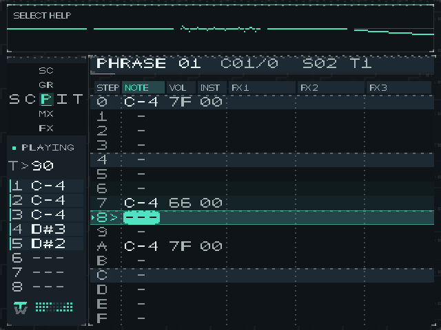

# TrackWerk 1.1

**Small machine. Serious music.** An eight-track music studio for Android and selected Linux handhelds, by **Kid Bunka**.

[Website](https://kidbee85-beep.github.io/TrackWerk/) · [Illustrated English guide](https://kidbee85-beep.github.io/TrackWerk/guide.html) · [Download 1.1](https://github.com/kidbee85-beep/TrackWerk/releases/tag/v1.1.0) · [Watch on YouTube](https://youtu.be/RA0bE7sNRhA) · [Optional support](https://www.paypal.com/donate/?business=kidbee85%40gmail.com&currency_code=CHF)

## A demo party in your pocket

Write sixteen steps, join phrases into chains, then arrange them over eight tracks. Find a recording, chop a motif, perform a transition and resample the result. TrackWerk connects the tracker to a sampler and a synth laboratory, with a workflow built for buttons.

- **40 complete Scenes / 10 families.** Terminal, BBS, DOS, raster and vector looks meet Daylight and Hardware. Choose among 54 palettes and independent typefaces. Cursor glide, soft scrolling and animated controls are optional; Motion can be disabled.
- **Sampling with context.** Browse archive recordings on supported connected profiles, preview a source, set a range and open the exported result in the Sample Editor. Keep creator, source and licence information with your material.
- **Studio synthesis.** 123 models with sixteen variation positions, including SID Chip, DCO Poly, FM SysEx banks, spectral and granular models. Load DX7 voice banks and save the selected FM voice with the song.
- **Ideas you can edit.** Drumlab suggests rhythms from your sounds. Harmony supplies 48 progression templates, locks and phrase output; its preview uses loaded samples, SoundFonts or external MIDI.
- **Performance with a way home.** Eight Punch banks, internal mix recording, track mute/solo, effects, mastering, mix and stem export. Hold a momentary move, release it, then record the good accident.
- **A proper handbook.** Illustrated English workflows, all forty Scenes, detailed tracker commands and practical installation/update instructions. The embedded 7:15 film includes native audio, English captions and chapter jumps.

## Choose your device

| Device | Package / operating system | Notes |
| --- | --- | --- |
| TrimUI Brick | KNULLI | Native ARM64 profile |
| Miyoo Mini | Onion / offline | Local media and synthesis; Apps and Ports label TrackWerk 1.1 |
| Miyoo Mini Plus | Onion / Archive | Supported online sources; optional offline installation is labelled separately |
| Powkiddy RGB20S | AmberELEC | Games-card package, preserving projects and settings |
| Android | Signed APK / Android 8+ | ARM64, ARMv7 and x86_64; versionCode 101004; same app ID and signer as 1.0 |

Use First Install for a new card and Program Update for an existing installation. Back up the data folder and follow START-HERE inside the matching ZIP. The Miyoo updater recognises 25 verified predecessors, including the installed b3aecfa development build; a menu-name helper also updates legacy Apps/Ports metadata. Install the Android APK over the existing app to retain its data. Do not uninstall just to update.

The factory library remains the same 2,432-preset collection; its unchanged 1.0 archive is included in the 1.1 release. Five public demo projects use internal synth engines. Sample-based soundtrack compositions are mixed audio; commercial raw sample-library files are excluded.

Networking, MIDI and external audio inputs depend on the platform and hardware. YouTube is off by default and requires an explicit opt-in. Check the actual recording's reuse terms before releasing sampled music. There is no universal polyphony or CPU claim: the workload depends on the project and device.

## Source, builds and credits

TrackWerk is a GPL-3.0-or-later fork of [PocketTracker by conanizer and contributors](https://github.com/conanizer/pockettracker). The upstream tracker, sample engine and button workflow are its foundation. See [BUILD-TRACKWERK.txt](BUILD-TRACKWERK.txt), [source](source/) and the [credits](https://kidbee85-beep.github.io/TrackWerk/credits.html). The release provides complete corresponding application source, licences and the exact Miyoo SDL source archive.

Selected DSP work uses open Mutable Instruments code by Emilie Gillet and contributors, alongside the other components listed in source/CREDITS.md and source/docs/licenses. Interface captures are genuine native renders; the film's navigation is scripted and device frames are illustrations. Soundtrack production credits identify the recordings and sample libraries used.

## More music tools by Kid Bunka

- [Mutable Dreams](https://kidbee85-beep.github.io/mutable-dreams/) — generative instruments and a Web Studio for the M-VAVE FM-1.
- [Performance Garden](https://github.com/kidbee85-beep/mutable-dreams-performance-garden) — the Mutable Dreams instrument for VIBE FM.
- [bazillOS](https://kidbee85-beep.github.io/bazillOS/) — independent firmware for the Polyend Tracker Mini.
- [Cut-A-Dor](https://github.com/kidbee85-beep/cut-a-dor-release) — rhythm firmware and a browser beat dojo for the FM-1.

[Optional donations](https://www.paypal.com/donate/?business=kidbee85%40gmail.com&currency_code=CHF) support firmware updates, new firmware and synthesizer software.
